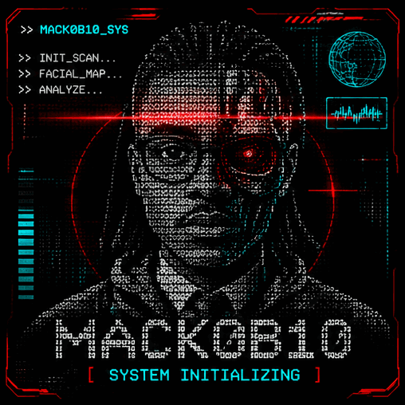

 <div align="center">



# MACK0B10

**JORDAN MACK**

`Computer Science @ SFSU` • `Cybersecurity Enthusiast` • `PC Gamer`

</div>

---

### 🟢 SYSTEM TERMINAL // WHOAMI

```text
┌──────────────────────────────────────────────────────┐
│  MACK0B10 TERMINAL                         [ONLINE]  │
├──────────────────────────────────────────────────────┤
│                                                      │
│  root@mack0b10:~$ whoami                             │
│                                                      │
│  [✓] USER IDENTIFIED                                 │
│                                                      │
│  NAME        : Jordan Mack                           │
│  ALIAS       : MACK0B10                               │
│  CLASS       : Computer Science Student              │
│  UNIVERSITY  : San Francisco State University        │
│  SPECIALTY   : Cybersecurity                          │
│  SIDE QUEST  : PC Gaming                              │
│  CURRENT XP  : Linux | Networking | Security+         │
│                                                      │
│  STATUS      : Learning. Building. Leveling Up.      │
│                                                      │
└──────────────────────────────────────────────────────┘
```

### 🔴 SECURITY OPERATIONS // CYBERSECURITY JOURNEY

```text
root@mack0b10:~$ ./security-status

[ SYSTEM INITIALIZED ]

[✓] Linux Fundamentals
[✓] TCP/IP & Network Reconnaissance
[✓] Nmap Service Enumeration
[✓] Node.js Security Event Logging
[~] Web Application Penetration Testing
[~] CompTIA Security+ Studies
[ ] Advanced Penetration Testing

--------------------------------------------

CURRENT OBJECTIVE:

> Understand how systems work.
> Discover how vulnerabilities happen.
> Learn how to detect and defend against attacks.

[ SECURITY RESEARCH IN PROGRESS... ]
```

### ⚡ CURRENT MISSION // ACTIVE PROJECT

**[Vulnerable Website Security Lab](https://github.com/mack0b10/Vulerable-Website-Lab)**

Building a hands-on cybersecurity environment using Node.js, Express, Kali Linux, and Nmap.

**Project objectives:**
- Develop a functional web application with authentication.
- Perform network reconnaissance and service enumeration.
- Monitor login attempts and suspicious activity.
- Practice web application security testing.
- Document vulnerabilities, findings, and remediation.

`STATUS: IN DEVELOPMENT`


### 🛠️ TOOLS & TECHNOLOGIES

<div align="center">


</div>

**Security Tools:** Kali Linux • Nmap • Wireshark • Burp Suite (Learning)

**Currently Studying:** CompTIA Security+ • Network Security • Web Application Security

---

<div align="center">

```text
[ MACK0B10 SYSTEM STATUS ]

ACCESS GRANTED
CURIOSITY ENABLED
LEARNING IN PROGRESS

> END OF TRANSMISSION_
```

</div> 
